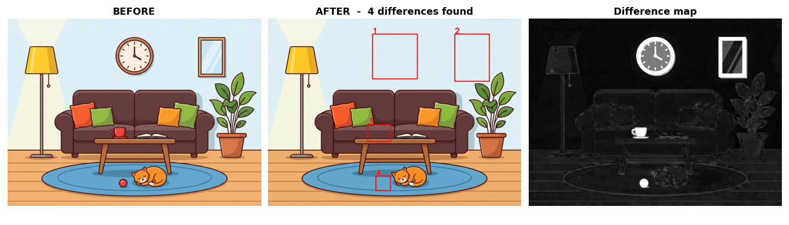
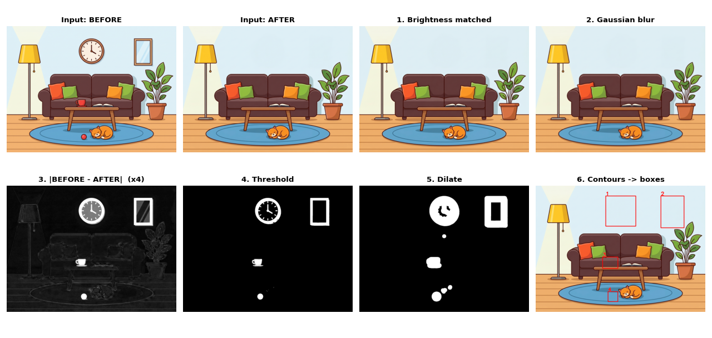

# 🔍 Spot the Difference

**Find what changed between two photos — with classical image processing, no machine learning.**

Upload two photos of the same scene (before / after) and the app draws a numbered box around everything that changed. It is built only with **OpenCV + NumPy**, with a **Gradio** web interface.



<!-- Live demo: add your Hugging Face Space link here when you have one -->

## ✨ Features

- Upload a *before* and an *after* photo → numbered boxes, a table (position, size, % of the image) and a difference map.
- Live controls: sensitivity threshold, noise blur, minimum change size, brightness compensation, and a region of interest (ROI).
- A demo pair is already loaded when the page opens.

## 🧠 How it works

The idea is *image differencing*: subtract one image from the other — where the result is big, something changed. Real photos need some preparation first, so the pipeline is:



| # | Step | Why |
|---|------|-----|
| 1 | **Resize** the AFTER photo to the BEFORE size (`INTER_AREA`) | pixels can only be compared at the same position |
| 2 | **Match brightness** (shift each channel by the difference of the means; `int16` + `clip` to avoid `uint8` wrap-around) | a darker second photo must not look like "everything changed" |
| 3 | **Gaussian blur** | removes camera noise, JPEG noise and tiny shifts |
| 4 | **`cv2.absdiff`** per channel, then the **max of B, G, R** | safe absolute difference (plain `uint8` subtraction wraps around); a change can show up in one channel only |
| 5 | **Threshold** (> T → 255, else 0) | turns "how much changed" into a yes / no mask |
| 6 | **ROI mask** (`bitwise_and`) | optionally compare only part of the image |
| 7 | **Dilate** | joins the pieces of one changed object into a single blob |
| 8 | **`findContours`** → drop blobs smaller than the minimum area → **`boundingRect`** | one box per real change |
| 9 | Draw the boxes on the AFTER photo, build the table and the difference map | output |

## 🚀 Quick start

```bash
git clone https://github.com/yasserr-mohamed/spot-the-difference.git
cd spot-the-difference
pip install -r requirements.txt
python app.py
```

Open the local address printed in the terminal (usually http://127.0.0.1:7860).

**Google Colab:** `!pip install gradio opencv-python numpy`, upload the files, then `!python app.py` — it prints a public link.

### Settings

| Setting | Default | What it does |
|---|---|---|
| Sensitivity threshold | 40 | lower = detects smaller changes, but more noise |
| Ignore changes smaller than | 0.3 % | removes tiny specks |
| Noise blur | 9 | bigger = ignores tiny shifts and JPEG noise (but also softens small objects) |
| Ignore overall brightness change | on | compensates when one photo is darker/brighter |
| Region (ROI) | whole image | compare only a rectangle (x1, y1, x2, y2 in %) |

**Tip:** take both photos from exactly the same position (a tripod, or lean the phone on something).

## ⚠️ Limitations

- **The photos must be aligned.** Pixels are compared at the same position, so if the camera moved, every edge looks "changed".
- It detects *that* something changed, **not what** — and it can't tell if an object appeared or disappeared.
- A shadow or sunlight on part of the image looks like a change (brightness compensation only handles a uniform shift).
- An object with almost the same colour as the background can be missed.

**Ideas for improvement:** align the two photos before subtracting (image registration), or use an object detector (e.g. YOLO) to say *what* changed.

## 📚 What I learned

- `uint8` arithmetic wraps around (`10 − 20 = 246`) — use `cv2.absdiff` and convert to `int16` before adding.
- Brightness matching matters: in a test where the second photo was uniformly darker, the whole image was flagged as one big change until the brightness was matched.
- Default values matter: on the demo pair, a 5×5 blur and a 0.05 % minimum size gave 11 boxes (7 of them JPEG noise); a 9×9 blur and 0.3 % gave exactly the 4 real changes.

## 🗂️ Project structure

```
spot-the-difference/
├── app.py            # web app (Gradio)
├── spot_diff.py      # the image-processing core (OpenCV + NumPy)
├── assets/           # demo photos and README images
├── requirements.txt
└── LICENSE
```

## 🛠️ Built with

Python · OpenCV · NumPy · Gradio

## 👤 Author

**Yasser Mohamed** — [LinkedIn](https://www.linkedin.com/in/yasser-mohamed-2a61b938b/)

Made for an *Image Pre-processing* course project.

## 📄 License

MIT — see [LICENSE](LICENSE).
